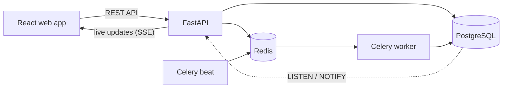

# British Auction RFQ System

A web app where **buyers** post freight requests (RFQs, "Requests for Quotation") and **suppliers** compete for
them in a live **British Auction**: suppliers keep lowering their prices, the lowest price wins, and a late bid
automatically extends the auction so nobody can snipe it in the last second. A **forced close** time is a hard stop
that no extension can pass.

**Stack:** React + TypeScript (Vite, TanStack Query) · FastAPI (Python 3.11) · PostgreSQL 16 · Redis · Celery ·
Docker Compose

## Contents

- [Features](#features)
- [How it works](#how-it-works)
- [Run it on your computer](#run-it-on-your-computer)
- [Try it out](#try-it-out)
- [Project structure](#project-structure)
- [Run without Docker](#run-without-docker)
- [Tests](#tests)
- [Deploy for free on Render](#deploy-for-free-on-render)
- [Configuration](#configuration)
- [Auction rules](#auction-rules)
- [Who sees what](#who-sees-what)
- [API reference](#api-reference)
- [Assumptions](#assumptions)
- [Troubleshooting](#troubleshooting)

More detail: [high-level design](docs/HLD.md) and [database schema](docs/schema.md).

## Features

- **Accounts for buyers and suppliers.** Register, log in, log out. The role is chosen once at sign-up and decides
  what the user can do.
- **Create RFQs** (buyers) with a bid start, bid close, forced close, pickup date and the auction settings:
  - **Trigger window X**: how many minutes before the close the auction "watches" for activity.
  - **Extension Y**: how many minutes to add when the trigger fires.
  - **Trigger type**: any bid, any change in supplier ranking, or a change of the lowest bidder (L1).
- **Place bids** (suppliers): carrier name, freight, origin and destination charges, transit time and quote validity.
  Each new bid must be lower than the supplier's previous one.
- **Live ranking** (L1, L2, …) with a countdown driven by the server's clock, so every browser agrees on the time.
- **Automatic extensions** with the reason written to an activity log, capped at the forced close.
- **Live updates** without refreshing the page.
- **Auction Closed result**: the winning supplier, winning bid and rank once bidding ends.
- **Private by role**: buyers only see their own RFQs; suppliers see their own rank and the current lowest price,
  but never competitors' names or prices.
- **Login protection**: after 5 failed attempts an email is locked for 15 minutes.

## How it works



- **PostgreSQL** stores everything. Every bid locks its RFQ row, so two bids in the same instant are processed one
  after the other and can never both extend the auction or push it past the forced close.
- When something changes, PostgreSQL notifies the API (`LISTEN / NOTIFY`) and the API pushes a small "changed" event
  to open browsers, which then reload the details they are allowed to see.
- **Redis** is the message broker for Celery and also stores the failed-login counts.
- **Celery** runs a background job (every 15 seconds in Docker) that records auctions starting and closing. The app never depends
  on it for correctness: the status is always computed from the server clock, and opening an RFQ records any missed
  change on the spot.

## Run it on your computer

You only need **[Docker Desktop](https://www.docker.com/products/docker-desktop/)** (Windows, macOS or Linux) and
**Git**. Docker sets up the database, Redis, the API, the background worker and the website for you.

1. **Start Docker Desktop** and wait until it says it is running.
2. **Download the code:**

   ```bash
   git clone https://github.com/anushkac15/british-auction.git
   cd british-auction
   ```

3. **Start everything** (the first run downloads and builds images and takes a few minutes):

   ```bash
   docker compose up --build
   ```

   It's ready when the log shows `Uvicorn running on http://0.0.0.0:8000`. To run it in the background instead, add
   `-d`: `docker compose up --build -d`.

4. **Open the app:** <http://localhost:3000>

   | Address | What it is |
   |---|---|
   | <http://localhost:3000> | The web app |
   | <http://localhost:8000/docs> | Interactive API documentation |

5. **Log in** with a demo account (all use the password `password123`), or register a new one:

   | Email | Role |
   |---|---|
   | `buyer@acme.test` | Buyer |
   | `bluedart@suppliers.test`, `maersk@suppliers.test`, `dhl@suppliers.test`, `gati@suppliers.test` | Supplier |

**Stop it** with `Ctrl+C` (or `docker compose down` if it runs in the background). Your data is kept for next
time. To wipe all data and start fresh: `docker compose down -v`.

## Try it out

Use two browser windows, for example a normal one and a private one, so you can be a buyer and a supplier at the
same time.

**As the buyer** (`buyer@acme.test`)

1. Click **Create RFQ**.
2. Fill in a reference ID and name, a bid start a couple of minutes from now, a bid close a few minutes later, a forced
   close after that, and a pickup date on or after the forced close date.
3. Choose the auction settings, for example X = 2 minutes, Y = 1 minute, trigger "Any supplier rank change".
4. Open the RFQ. You'll see the countdown, the full ranking with every supplier's quote, and the activity log.

**As a supplier** (for example `bluedart@suppliers.test`)

1. The home page lists buyers. Pick **Acme Buyer**, then the RFQ.
2. Once bidding opens, submit a quote. You'll see your rank ("L2 of 3") and the current lowest price, but not who
   offered it.
3. Bid again inside the last X minutes and change the ranking: the close time moves later and the activity log
   explains why.

When the auction ends, the page shows **Auction Closed** (or **Force Closed** if it ran into the forced close) with the
winning supplier, the winning bid and the rank.

### Automatic demo (about 6 minutes)

A script can play the suppliers for you, so you can just watch extensions happen:

```bash
docker compose exec api python -m app.seed --demo      # creates a demo RFQ and prints its id
python scripts/demo_bidder.py --rfq <id>               # needs Python 3.10+ on your computer, nothing to install
```

Open `http://localhost:3000/rfqs/<id>` as the buyer. The demo RFQ opens after 10 seconds, is due to close after about 3
minutes and force-closes after about 6, with X = 1 minute, Y = 1 minute and the "any rank change" trigger. You'll see
the countdown jump on every extension, the reasons in the activity log, one "cap reached" entry, and finally
**Force Closed**.

## Project structure

```
british-auction/
├── backend/                 FastAPI app (Python)
│   ├── app/
│   │   ├── main.py          app setup and error handling
│   │   ├── config.py        settings read from environment variables
│   │   ├── models/          database tables (SQLAlchemy)
│   │   ├── schemas/         request and response shapes (Pydantic)
│   │   ├── routers/         API endpoints: auth, rfqs, live stream
│   │   ├── services/        auction engine, ranking, status, role-based views
│   │   ├── tasks/           Celery background job
│   │   ├── throttle.py      failed-login limit
│   │   └── seed.py          demo accounts and demo RFQ
│   ├── alembic/             database migrations
│   ├── tests/               94 tests (run against real PostgreSQL)
│   ├── Dockerfile
│   └── start.sh             runs migrations, then starts the API
├── frontend/                React app (TypeScript)
│   ├── src/
│   │   ├── pages/           login, register, lists, create RFQ, auction details
│   │   ├── components/      ranking table, bid form, countdown, activity log
│   │   ├── hooks/           server clock, live updates, current user
│   │   └── api/             API client and types
│   ├── nginx.conf           serves the built app and forwards /api to the backend
│   └── Dockerfile
├── docker/                  creates the test database
├── docs/                    design and schema documentation
├── scripts/demo_bidder.py   automatic bidding demo
├── docker-compose.yml       the whole stack for local use
└── render.yaml              free deployment on Render
```

## Run without Docker

Useful if you want to change the code with instant reloads. You need **Python 3.11+**, **Node.js 20+**,
**PostgreSQL** on `localhost:5432` with user and password `auction` and the databases `auction` and `auction_test`,
and optionally **Redis** (only for the Celery worker and the shared login limit).

Easiest: let Docker run just the database and Redis with `docker compose up -d postgres redis`.

**Backend** (terminal 1):

```bash
cd backend
python -m venv .venv
.venv\Scripts\activate                 # macOS/Linux: source .venv/bin/activate
pip install -r requirements-dev.txt
alembic upgrade head                   # create the tables
python -m app.seed                     # create the demo accounts
uvicorn app.main:app --reload --port 8000
```

**Background worker** (optional, terminals 2 and 3, needs Redis):

```bash
celery -A app.tasks.celery_app worker --loglevel=info --pool=solo
celery -A app.tasks.celery_app beat --loglevel=info
```

**Frontend** (another terminal):

```bash
cd frontend
npm install
npm run dev                            # http://localhost:5173, forwards /api to port 8000
```

## Tests

The 94 backend tests run against **real PostgreSQL** (not SQLite), because the app relies on row locks
(`SELECT ... FOR UPDATE`), `DISTINCT ON`, partial unique indexes and generated columns. The test database is created
and migrated automatically.

```bash
docker compose exec api pytest         # with the Docker stack running
# or, without Docker:  cd backend && pytest
```

They cover:

- registration, login, invalid or expired tokens, and the failed-login lock
- production settings (weak secret keys are rejected) and the Redis login limit
- every trigger type and each rank-change case in the table below
- bids exactly at the close time (rejected), the forced-close cap, and Closed vs Force Closed
- exact money arithmetic (`0.10 + 0.20 = 0.30`) and the create-form rules
- suppliers never seeing competitor names or prices, and buyers never seeing other buyers' RFQs
- the live-update stream refusing anonymous users and the wrong buyer
- the background job being safe to run twice
- many threads bidding at once, with no lost extension and no overshoot of the forced close

The clock can be swapped out (`app/clock.py`), so tests freeze time instead of sleeping.

## Deploy for free on Render

[`render.yaml`](render.yaml) describes the whole deployment, so Render can set it up in one go, on free plans with no
card required:

```
React (static site) ──/api/*──► FastAPI ──► PostgreSQL   (data + live update notifications)
                                   │
                                   └──────► Redis        (failed-login counts)
```

1. Push this repository to your GitHub account.
2. Sign up at [render.com](https://render.com) with GitHub, choose **New → Blueprint**, and select the repository.
   Render creates the database, Redis, the API and the website, and generates a secret key.
3. When the first deploy finishes, open the API service and copy its address (Render adds a suffix such as
   `-mml8` if the name is taken). Put it in the `/api/*` rewrite at the end of `render.yaml` and push; Render
   redeploys the website with the new rule.
4. Open the `british-auction-web` address and register the first buyer and supplier. Demo accounts are not created in
   deployments.

**No background worker on the free plan.** Render charges for background workers, so the Celery worker isn't
deployed there. The app still behaves correctly: the status shown is always computed from the server clock, bids are
checked against the clock, and opening an RFQ records any start or close that was missed, with the time it actually
happened. The worker only keeps stored statuses up to date for RFQs nobody opens. The code stays in the repository,
and `docker-compose.yml` runs it as separate `worker` and `beat` containers, the same way a paid or self-hosted
deployment would.

**Free-plan limits:** the API sleeps after 15 idle minutes (the next request takes 30–60 seconds to wake it), and the
free database is deleted after 30 days. If the live-update connection is cut, the page falls back to checking every
3 seconds.

## Configuration

All settings are environment variables (or a `backend/.env` file). The defaults suit local development.

| Variable | Default | What it does |
|---|---|---|
| `APP_ENV` | `development` | `production` refuses to start without a strong `SECRET_KEY` and hides the API docs |
| `DATABASE_URL` | local PostgreSQL | `postgres://...` URLs from hosting providers work as they are |
| `REDIS_URL` | `redis://localhost:6379/0` | Redis for Celery and the login limit |
| `SECRET_KEY` | development value | Signs login tokens. In production use 32+ random characters: `python -c "import secrets; print(secrets.token_urlsafe(32))"` |
| `TOKEN_TTL_MINUTES` | `720` | How long a login lasts (12 hours) |
| `LOGIN_MAX_FAILURES`, `LOGIN_LOCKOUT_SECONDS` | `5`, `900` | Failed logins allowed per email, and the lock time |
| `LOGIN_THROTTLE_STORE` | `memory` | `redis` shares the failed-login count between API processes |
| `SEED_DEMO_USERS` | unset | `true` creates the demo accounts on start (set in `docker-compose.yml`) |
| `CORS_ORIGINS` | local addresses | Websites allowed to call the API directly |
| `SWEEP_INTERVAL_SECONDS` | `30` | How often the background job runs (`docker-compose.yml` sets 15) |
| `PORT`, `WEB_CONCURRENCY` | `8000`, `2` | API port and number of API processes in the container |

Never commit a real `.env` file; it is listed in `.gitignore`.

## Auction rules

### Accepting a bid
- A bid is accepted only while `bid_start_at <= now < bid_close_at`, using the server clock and checked while the
  RFQ is locked. A bid at exactly the close time is rejected.
- Charges must be `0` or more with at most 2 decimals, transit time more than `0` days, and the quote valid on or
  after the pickup date.
- A supplier's new total must be **strictly lower** than their own previous total.

### Extensions
- The trigger is checked only when `now >= bid_close_at - X`, where `bid_close_at` is the current (possibly already
  extended) close time.
- When it fires: `new close = min(current close + Y, forced close)`. The extension counts from the current close time,
  not from the moment of the bid.
- If the forced close shortens the extension, the log says "extended to the forced close (cap reached)".
- Once the close time equals the forced close, `EXTENSION_CAPPED` is logged **once** and later triggers add nothing.

### What counts as a rank change
Ranking uses each supplier's latest bid, lowest total first. **On a tie, the earlier bid ranks higher.**

| Situation | "Any rank change" | "L1 change" |
|---|---|---|
| First bid in an empty auction | Yes | Yes |
| A new supplier's first bid lands in last place | **Yes** (a new entry changes the order) | No |
| A supplier lowers their price but keeps the same position | **No** (the order is the same) | No |
| A supplier lowers their price and overtakes someone, but not L1 | Yes | No |
| A supplier becomes the new L1 | Yes | Yes |
| L1 lowers their own price | No | No |
| A supplier matches another's price | No (the earlier bid stays ahead) | No |

"Bid received in last X minutes" fires on every accepted bid inside the window.

### Status
| Status | When (server time) |
|---|---|
| Upcoming | before the bid start |
| Active | between the bid start and the current close |
| Force Closed | after the close, when the close had reached the forced close |
| Closed | after the close otherwise |

### Create-form checks (enforced by the API and shown in the form)
- The bid start is in the future (10 seconds of clock difference allowed).
- Bid close is after the start; forced close is after the bid close.
- The pickup date is on or after the forced close date (UTC).
- X and Y are between 1 and 60 minutes, and X can't be longer than the auction.
- The reference ID is unique, and times include a time zone.

## Who sees what

| | Buyer | Supplier |
|---|---|---|
| Auction list | Only RFQs they created | All RFQs, grouped by buyer |
| Ranking | Every supplier with name and full quote | Only their own row and rank ("L2 of 5") |
| Prices | Everything | Their own bids and the current lowest price, without the name |
| Activity log | Full | Competitors shown as "A competitor", without prices |
| Actions | Create RFQs | Place bids |

A buyer opening another buyer's RFQ gets "not found".

## API reference

Every response, including errors, contains `server_now`. Money values are strings (for example `"40000.00"`) so no
precision is lost. Except for register and login, send the token from login as
`Authorization: Bearer <access_token>`. Interactive docs: <http://localhost:8000/docs> (local only).

| Method | Path | Who | What it does |
|---|---|---|---|
| POST | `/api/auth/register` | anyone | `{name, email, password (8+ characters), role: BUYER or SUPPLIER}`, returns a token and the user |
| POST | `/api/auth/login` | anyone | `{email, password}`, returns a token and the user |
| GET | `/api/auth/me` | logged in | The current account |
| GET | `/api/rfqs` | logged in | RFQ list (filtered by role): name, lowest bid, close times, status, and the supplier's own rank |
| POST | `/api/rfqs` | buyer | Create an RFQ with its auction settings |
| GET | `/api/rfqs/{id}` | owning buyer, any supplier | RFQ details, shaped by role |
| POST | `/api/rfqs/{id}/bids` | supplier | Place a bid; returns the rank, any extension and the new close time |
| GET | `/api/rfqs/{id}/stream` | owning buyer, any supplier | Live "changed" events (the RFQ id only) |
| GET | `/api/health` | anyone | Health check |

## Assumptions

- Ranking is by total price (freight + origin + destination); the earlier bid wins a tie.
- "Suppliers submit bids openly" is read as: suppliers see the live lowest price and their own rank, but not who their
  competitors are or what they bid. They have a clear target to beat, and collusion is harder, as in common
  reverse-auction practice.
- Money is stored exactly (`NUMERIC(12,2)` and Python `Decimal`), in one currency shown as INR.
- Any supplier can bid on any RFQ; there are no invitation lists.
- Login uses email and password with 12-hour tokens. If Redis is unreachable, logins are allowed rather than blocked.
  Email verification and password reset are out of scope. Logging out removes the token from the browser; it stays
  valid until it expires.

## Troubleshooting

| Problem | Fix |
|---|---|
| `docker: command not found` or "cannot connect to the Docker daemon" | Start Docker Desktop and wait until it is running. |
| "port is already allocated" | Something else uses port 3000, 8000, 5432 or 6379. Stop it, or change the left-hand number under `ports:` in `docker-compose.yml` (for example `"3001:80"`). |
| The page loads but login fails right after starting | The API is still starting. Wait for `Uvicorn running` in `docker compose logs api`. |
| Demo accounts don't work | They exist only in the local Docker setup. Run `docker compose exec api python -m app.seed` to recreate them. |
| "Too many failed login attempts" | Wait 15 minutes, or clear the lock locally: `docker compose exec redis redis-cli DEL login-failures:<email>`. |
| You want to see what's happening | `docker compose logs -f api worker` |
| You want a completely clean start | `docker compose down -v`, then `docker compose up --build` (deletes all data). |
