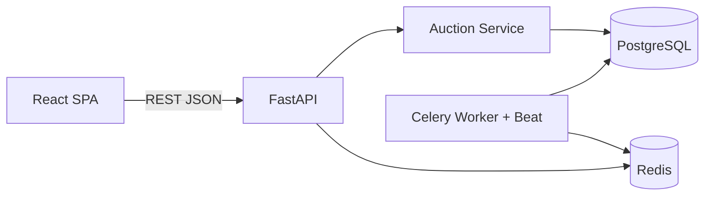

# British Auction RFQ System - Tech Plan

## 1. Stack (matches the JD)
- Backend: Python 3.11, FastAPI, SQLAlchemy 2 + Alembic, Pydantic v2
- DB: PostgreSQL
- Frontend: React + Vite + TypeScript, React Router, TanStack Query, plain CSS or Tailwind
- Background: Celery + Redis (auction status sweeper). Optional for MVP; the status is also computed lazily on read.
- Infra: Docker Compose (api, web, postgres, redis, celery worker)
- Neo4j: skipped (not needed; mention as optional)

## 2. Architecture (HLD)

Layers: routers -> services (business rules, extension engine) -> repositories/models. The frontend polls (every 3-5s) on the details page. WebSockets/SSE are a later upgrade.

## 3. Schema
- users: id, name, email, role (BUYER | SUPPLIER)
- rfqs: id, reference_id (unique), name, buyer_id, pickup_date, bid_start_at, bid_close_at (current, mutable), original_bid_close_at, forced_close_at, status (SCHEDULED | ACTIVE | CLOSED | FORCE_CLOSED), created_at
  - CHECK forced_close_at > bid_close_at, bid_close_at > bid_start_at
- auction_configs (1:1 with rfq): rfq_id, trigger_window_minutes (X), extension_minutes (Y), trigger_type (ANY_BID | ANY_RANK_CHANGE | L1_CHANGE)
  - CHECK X > 0, Y > 0
- bids: id, rfq_id, supplier_id, carrier_name, freight_charges, origin_charges, destination_charges, total_price (computed and stored), transit_time_days, quote_validity_date, is_latest (bool), created_at
  - Each supplier's latest bid counts for ranking. Older bids are kept as history.
  - Index (rfq_id, supplier_id, created_at).
- activity_logs: id, rfq_id, event_type (BID_SUBMITTED | TIME_EXTENDED | AUCTION_STARTED | CLOSED | FORCE_CLOSED), message/reason, old_close_at, new_close_at, supplier_id, created_at

## 4. Core business logic (the key part)
On `POST /rfqs/{id}/bids`, run in one transaction with `SELECT ... FOR UPDATE` on the rfq row, so concurrent bids are serialized:
1. Validate: the auction is ACTIVE and now is between start and current close (and under forced close). The bid must be lower than that supplier's own previous total (it must be strictly lower once a bid exists). Charges must be >= 0.
2. Compute the ranking before the bid (latest bid per supplier, sorted by total ascending, ties broken by earliest time).
3. Insert the bid, recompute the ranking after.
4. If now is within [close - X, close], evaluate the trigger:
   - ANY_BID: always true
   - ANY_RANK_CHANGE: the ordered supplier list differs before vs after
   - L1_CHANGE: the L1 supplier differs before vs after
5. If triggered: new_close = min(close + Y, forced_close). Update the rfq and log TIME_EXTENDED with the reason (for example "Rank change at 5:58 PM"). If already capped at forced_close, log that the cap was reached.
6. Log BID_SUBMITTED.

Status resolution: a pure function `resolve_status(rfq, now)`. ACTIVE before the close time. After the close: CLOSED if the close time was reached normally, FORCE_CLOSED if the close time equals forced_close_at. It is applied lazily on read and by a Celery beat job every minute that writes the final status and log entry. Bids are rejected after the close time.

## 5. API
- POST /rfqs (create RFQ plus config, validated)
- GET /rfqs (listing: name/ID, lowest bid, current close, forced close, status)
- GET /rfqs/{id} (details: config, ranked bids with quote details, activity log)
- POST /rfqs/{id}/bids
- GET /rfqs/{id}/activity
- Simple auth: a role selector or header-based user (X-User-Id) with seeded buyer and suppliers. Full JWT is out of scope unless you want it.

## 6. Frontend pages
- Auction Listing: table with status badges and a "Create RFQ" button
- Create RFQ form: all fields, X, Y, trigger dropdown, client-side validation (forced > close)
- Auction Details: config panel, countdown timers (current close and forced close), ranked bids table (L1, L2, ...) with charges/transit/validity, bid submission form (supplier view), activity log timeline with extension reasons. Polling for live updates.

## 7. Validation
- Pydantic validators plus DB CHECK constraints for forced > close > start
- Extension never exceeds forced close (enforced in the service and covered by tests)

## 8. Project structure
```
backend/app/{main.py, models/, schemas/, routers/, services/(auction_engine.py), tasks/, db.py}
backend/alembic/, backend/tests/
frontend/src/{pages/, components/, api/, hooks/}
docker-compose.yml, docs/HLD.md, docs/schema.md, README.md
```

## 9. Testing
Unit tests for the extension engine: each trigger type, a bid outside the window, a bid at the exact boundary, the forced-close cap, a bid after close, and concurrent bids.

## 10. Milestones
1. Scaffold: Docker Compose, DB models, migrations, seed data
2. Backend: RFQ create/list/details, bid engine, activity log, tests
3. Celery status sweeper
4. Frontend: listing, create form, details page
5. Polish: README, HLD diagram, schema doc

## Assumptions to confirm
- Bids must be lower than the supplier's previous bid, and rank is by total price (freight + origin + destination).
- Ties are broken by the earlier bid.
- Role handling is lightweight (no real login).
- Polling instead of WebSockets.