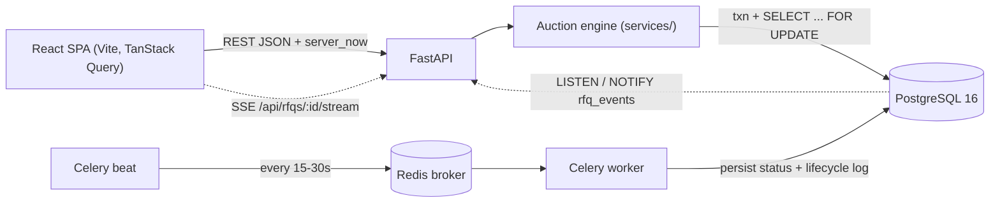
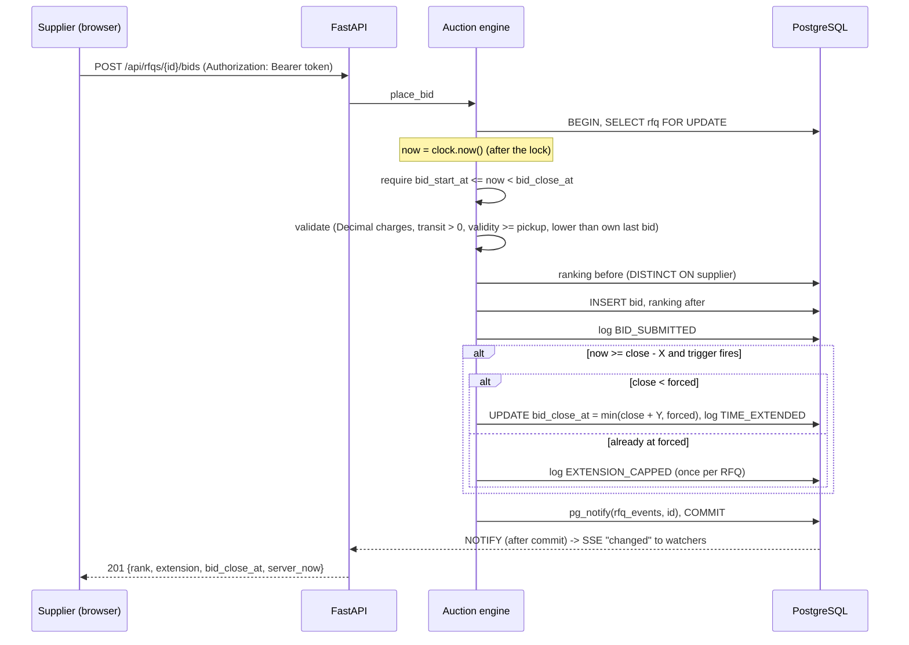

# High-Level Design

## Architecture



| Component | Responsibility |
|---|---|
| React SPA | Listing, create-RFQ form, auction details. Countdowns run on the **server clock** (offset computed from `server_now`). Polls every 3s while an auction is live; SSE, when connected, triggers instant refetches and polling slows to 15s. |
| FastAPI | REST API, request validation (Pydantic), role-based response shaping, SSE endpoint. |
| Auction engine | Bid acceptance, ranking, trigger evaluation, extensions, forced-close cap, activity log. |
| PostgreSQL | Source of truth. CHECK constraints, generated `total_price`, partial unique index for once-per-RFQ events, row locks, LISTEN/NOTIFY. |
| Celery beat + worker | Periodic sweeper that persists status transitions (`UPCOMING -> ACTIVE -> CLOSED/FORCE_CLOSED`) and writes their log entries. |
| Redis | Celery broker, and failed-login counts shared by the API processes. |

## Code layout

```
backend/app/
  main.py              app, CORS, error handlers (every error includes server_now)
  config.py db.py      settings, engine (sessions pinned to UTC)
  clock.py             injectable clock (SystemClock / FrozenClock for tests)
  security.py          scrypt password hashing, HMAC-signed bearer tokens
  deps.py              bearer-token auth, buyer/supplier guards
  models/              SQLAlchemy models (see schema.md)
  schemas/             Pydantic input/output models (Decimal money)
  routers/             auth (register/login/me), rfqs, stream (SSE)
  services/
    auction_engine.py  place_bid, create_rfq, evaluate_trigger
    ranking.py         DISTINCT ON latest-bid query + ranking order
    status.py          resolve_status, sync_status, sweep
    views.py           role-based shaping (buyer vs supplier)
    activity.py        log_event (ON CONFLICT for once-per-RFQ events), pg_notify
  events.py            LISTEN thread -> asyncio fan-out for SSE
  tasks/               Celery app + sweeper task
  seed.py              users + live demo RFQ
```

## Bid flow



## Key decisions

- **Authentication.** Buyers and suppliers register with a name, email, password and role, then log in to get a
  bearer token (`base64url(claims).HMAC-SHA256`, signed with `SECRET_KEY`, 12 h expiry). Passwords are stored
  as salted scrypt hashes. Both use only the Python standard library. The role is fixed at registration and decides
  what the API lets the user do. The SPA keeps the token in `localStorage` and logs out on any 401.

- **Concurrency.** All bids for one RFQ are serialized by a row lock on `rfqs`. The time check, ranking, and
  extension all happen under that lock, so two simultaneous last-second bids can neither both read a stale
  close time nor push it past the forced close. Covered by a multi-threaded test on Postgres.
- **Time is the source of truth.** Bids are accepted purely on `bid_start_at <= now < bid_close_at`.
  The stored `status` is a cache maintained by the sweeper (and self-healed on detail reads), so a lagging
  worker can never let a late bid in or block an early one.
- **UTC everywhere.** `TIMESTAMPTZ` columns, DB sessions pinned to `timezone=UTC`, API returns ISO-8601 UTC.
  The browser converts to local time only for display.
- **Server clock for countdowns.** Each response carries `server_now`; the client keeps an offset
  (round-trip-compensated) and computes all countdowns and live status from it.
- **Money.** `NUMERIC(12,2)` in Postgres, `Decimal` in Python, strings in JSON, BigInt cents in the browser.
- **Append-only bids.** No `is_latest` flag to keep in sync; the latest bid per supplier comes from
  `DISTINCT ON (supplier_id) ... ORDER BY created_at DESC`.
- **Live updates.** Polling is the baseline. SSE is layered on top using Postgres `LISTEN/NOTIFY`
  (notifications are only delivered on commit, so clients never see uncommitted state). The SSE payload is
  just the RFQ id; clients refetch the role-shaped details, so nothing sensitive is broadcast. The stream
  still requires the bearer token and the detail endpoint's access rule, so outsiders can't watch activity.
  The SPA reads it with `fetch` (not `EventSource`, which can't send headers), so tokens never go in URLs.
