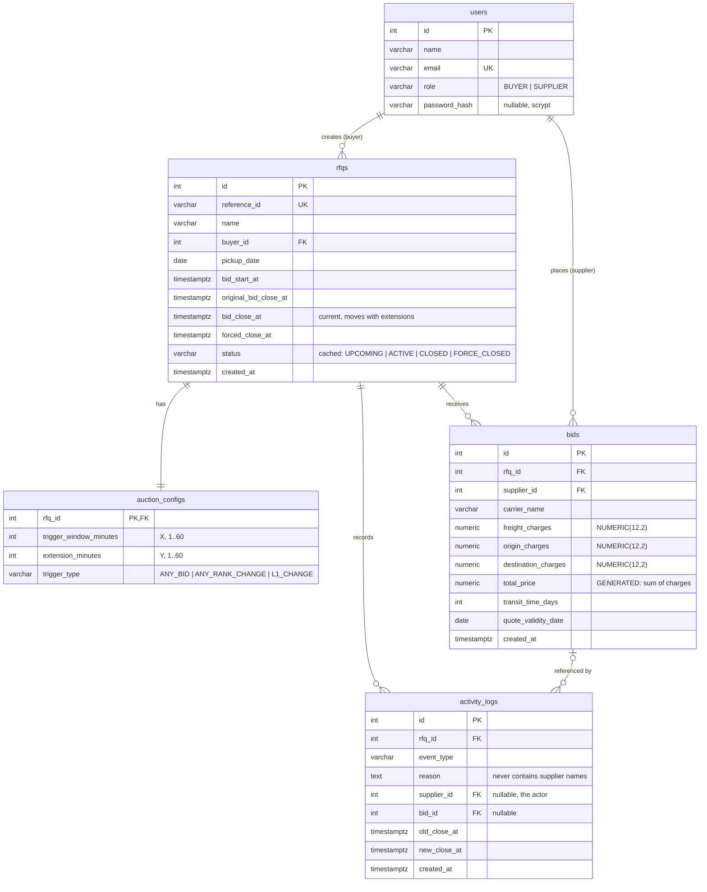

# Database Schema (PostgreSQL 16)

Migrations: [`0001_initial.py`](../backend/alembic/versions/0001_initial.py),
[`0002_user_passwords.py`](../backend/alembic/versions/0002_user_passwords.py),
[`0003_fix_check_constraint_names.py`](../backend/alembic/versions/0003_fix_check_constraint_names.py),
[`0004_rfqs_buyer_index.py`](../backend/alembic/versions/0004_rfqs_buyer_index.py).
All timestamps are `TIMESTAMPTZ` stored in UTC. Enums are `VARCHAR` + `CHECK` constraints.



## Constraints

| Table | Constraint | Purpose |
|---|---|---|
| users | `UNIQUE (lower(email))` | One account per email, case-insensitive |
| rfqs | `original_bid_close_at > bid_start_at` | Valid auction window |
| rfqs | `forced_close_at > original_bid_close_at` | Forced close later than the planned close |
| rfqs | `bid_close_at > bid_start_at` | |
| rfqs | `bid_close_at <= forced_close_at` | Extensions never pass the forced close; **equality allowed** for a capped extension |
| rfqs | `bid_close_at >= original_bid_close_at` | Close time only ever moves forward |
| rfqs | `UNIQUE (reference_id)` | |
| auction_configs | `trigger_window_minutes BETWEEN 1 AND 60`, `extension_minutes BETWEEN 1 AND 60` | Sensible X / Y |
| bids | each charge `>= 0`, `transit_time_days > 0` | |
| activity_logs | `UNIQUE (rfq_id, event_type) WHERE event_type IN ('RFQ_CREATED','AUCTION_STARTED','EXTENSION_CAPPED','CLOSED','FORCE_CLOSED')` | At most one `EXTENSION_CAPPED` (and one of each lifecycle event) per RFQ; inserts use `ON CONFLICT DO NOTHING` |

## Indexes

- `bids (rfq_id, supplier_id, created_at DESC)`: serves the latest-bid-per-supplier query.
- `activity_logs (rfq_id, created_at)`: activity timeline.
- `rfqs (status)`: the sweeper's "due transitions" scan.
- `rfqs (buyer_id)`: a buyer's own RFQ list.

## Latest bid per supplier

```sql
SELECT DISTINCT ON (supplier_id) *
FROM bids
WHERE rfq_id = :rfq_id
ORDER BY supplier_id, created_at DESC, id DESC;
```

Ranking then sorts these by `(total_price ASC, created_at ASC, id ASC)`: on equal totals the earlier bid
keeps the better rank.
